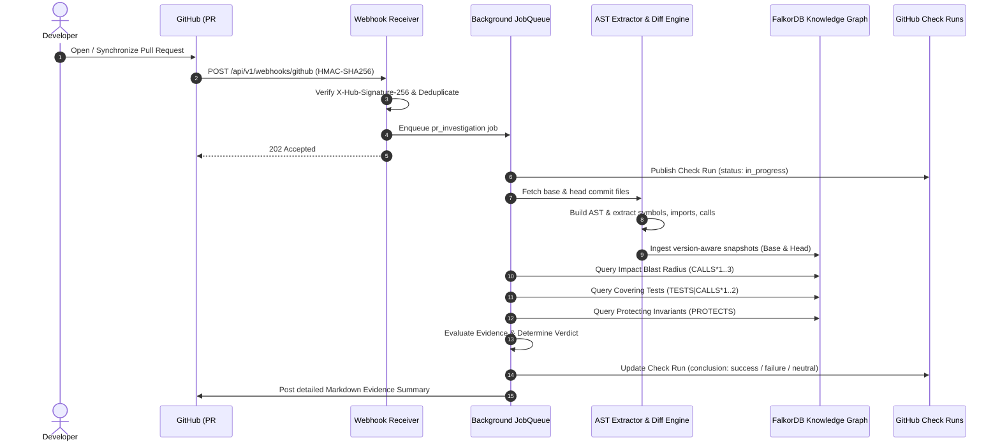
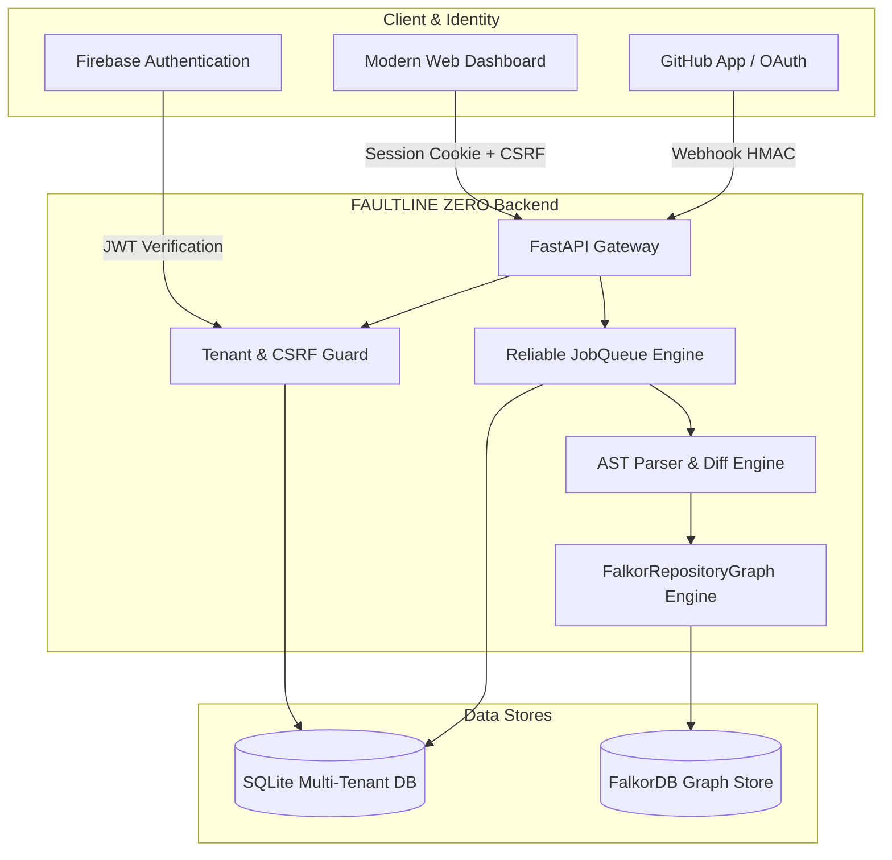
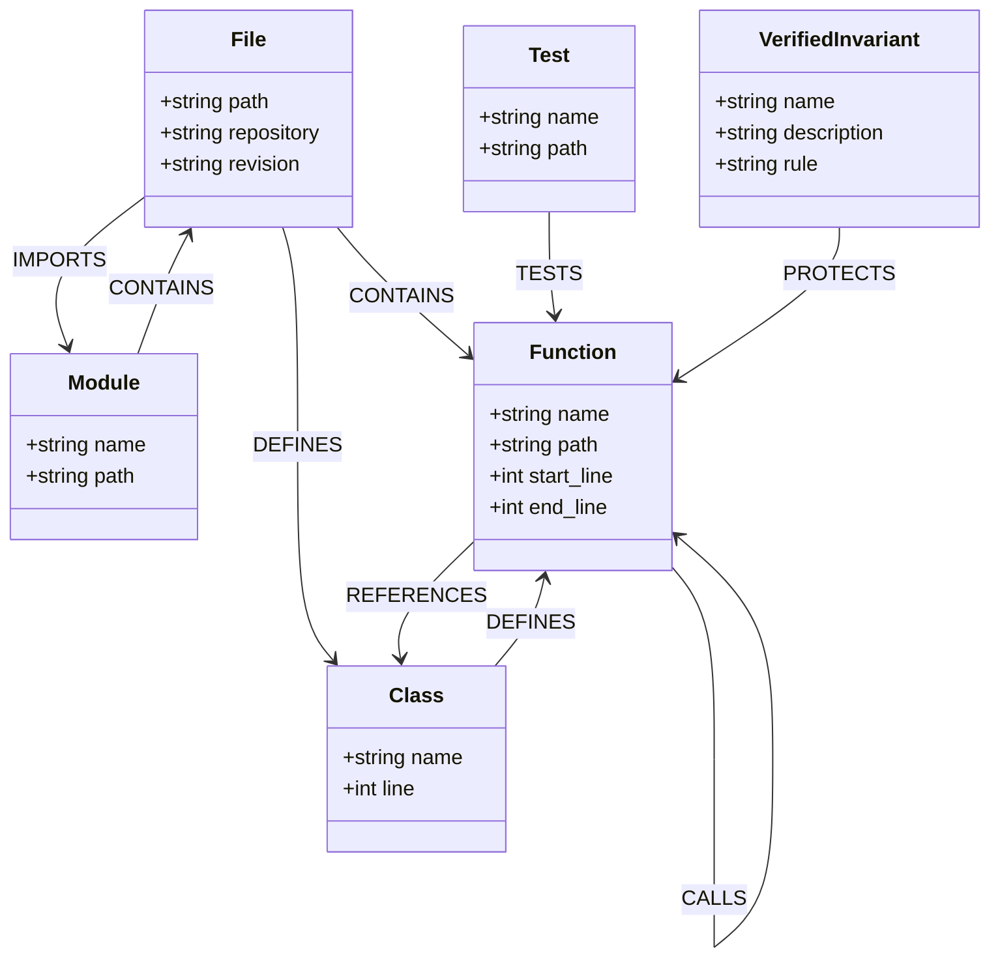
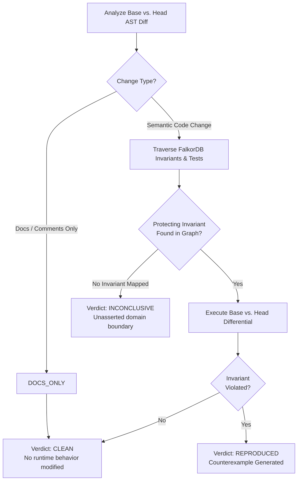

# FAULTLINE ZERO

## Autonomous Graph-Native Pre-Merge Regression Gate
> **"Evidence before confidence."**  
> *Your tests passed. Your code can still break. Find the break. Prove the cause.*

[](https://wemakedevs.org)
[](https://falkordb.com)
[](https://fastapi.tiangolo.com)
[](https://www.docker.com)
[]()

---

## 🎥 Working Demo

[Watch FAULTLINE ZERO in Action](ADD_GOOGLE_DRIVE_VIDEO_URL_HERE)

---

## 1. What FAULTLINE ZERO Does & The Problem It Solves

Modern continuous integration (CI) pipelines suffer from a silent, fundamental flaw: **a green test suite does not guarantee that critical business logic remains intact.** Fixed test suites verify only what past developers remembered to assert. When a code modification affects unasserted dependencies, cross-service contracts, or edge-case financial invariants, standard CI reports a false-positive pass.

**FAULTLINE ZERO** is an autonomous, graph-native pre-merge regression intelligence platform. Instead of trusting green test suites or relying on LLMs that hallucinate, FAULTLINE ZERO parses code into an immutable, version-aware knowledge graph in **FalkorDB**, performs multi-hop reachability and dependency blast-radius traversal, and publishes evidence-backed verdicts to GitHub Check Runs before pull requests merge into `main`.

---

## 2. Implemented Features & Language Support

- **Graph-Native Repository Indexing**: Automated AST extraction parsing Python and JavaScript/TypeScript repositories into semantic graph primitives without storing raw code in the database.
- **Commit-Specific Snapshot Isolation**: Every branch and commit SHA maintains an isolated snapshot in FalkorDB (`tenant:repo@commit_sha`), ensuring comparisons compare exact revisions without state contamination.
- **Bi-Directional AST Diffing**: Accurately classifies changes into `ADDED`, `REMOVED`, `DOCS_ONLY`, and `SEMANTIC_MODIFIED` by comparing AST node structures, docstrings, and function bodies.
- **Multi-Tenant SaaS Architecture**: Strict tenant isolation across organizations, memberships, repositories, and FalkorDB graphs with role-based access control (RBAC).
- **Vercel-Style 1-Click GitHub Onboarding**: Seamless OAuth integration with automatic repository discovery, background indexing, and zero redundant modals.
- **Real GitHub App Integration**: Signed HMAC-SHA256 webhook validation, GitHub App installation token generation, and GitHub Check Run publication.
- **Dual-Branch Differential Verification**: Executes differential scenarios across base and head branches to empirically reproduce regressions.
- **Interactive Multi-View Dependency Graph Explorer**: Cytoscape/ELK graph visualization in the SaaS dashboard with neighborhood expansion and symbol inspection.

---

## 3. Real GitHub PR Investigation Workflow



1. **Webhook Ingestion**: GitHub sends `pull_request.opened` or `pull_request.synchronize` events. FAULTLINE ZERO verifies the cryptographic signature with constant-time HMAC comparison.
2. **Immediate Progress Check**: A GitHub Check Run is instantly created with status `in_progress`.
3. **AST Extraction & Graph Building**: Python/JS code is parsed into function, class, module, and import definitions.
4. **FalkorDB Snapshot Ingestion**: Nodes and relationships are merged into FalkorDB under tenant and revision namespaces.
5. **Graph Impact Traversal**: Upstream callers, covering test cases, and protecting invariants are resolved via Cypher queries.
6. **Verdict Determination**: Evaluates semantic modifications against invariant rules and test coverage.
7. **Check Run Publication**: Results with evidence breakdown, blast radius, and unverified scope are posted to GitHub.

---

## 4. Technical Architecture



- **API Layer**: FastAPI 0.146.0 running on Python 3.12/3.14 with strict Pydantic schemas, dependency injection, and fail-closed security.
- **Graph Store**: **FalkorDB** high-performance in-memory graph database running on Redis protocol with Cypher query execution.
- **Relational Metadata**: SQLite database handling tenant memberships, user profiles, background job states, and repository settings.
- **Authentication**: Firebase Web SDK on frontend, Firebase Admin SDK with local JSON credential binding on backend, plus secure session cookies with CSRF tokens.

---

## 5. FalkorDB as the Central Knowledge Graph

FalkorDB is the core intelligence engine of FAULTLINE ZERO. Traditional pre-merge tools treat code as flat text diffs. FAULTLINE ZERO transforms code into a connected property graph that models the exact semantics of the codebase:

- **Version-Aware Isolation**: Every node's ID is scoped: `{tenant}:{repo}@{revision}:{kind}:{name}`. This allows multiple branches, commits, and pull requests to coexist in the graph without conflict.
- **Tenant Partitioning**: Each organization/tenant slug owns an isolated FalkorDB graph (`faultline_{tenant_slug}`), preventing cross-tenant data leakage.
- **Memory Efficiency**: The graph stores structural relationships, function signatures, caller paths, and invariant mappings — raw source code is never permanently persisted in the graph.

---

## 6. Graph Schema: Node Types & Edge Relationships



### Node Types
| Label | Description |
|---|---|
| `:File` | Source code file located within the repository |
| `:Module` | Package or module namespace containing files |
| `:Class` | Object-oriented class definition |
| `:Function` | Executable function, method, or callable symbol |
| `:Test` | Automated test function or test case (`test_*`, `TestCase`) |
| `:VerifiedInvariant` | Formally registered business or financial invariant rule |

### Edge Relationships
| Relationship | Description | Direction |
|---|---|---|
| `CONTAINS` | Structural hierarchy from module to file or file to function | `(:Module)-[:CONTAINS]->(:File)` |
| `DEFINES` | Declaration of a class or function within a file/class | `(:File)-[:DEFINES]->(:Class)` |
| `IMPORTS` | Dependency import between a file and a module | `(:File)-[:IMPORTS]->(:Module)` |
| `CALLS` | Static or resolved function call invocation | `(:Function)-[:CALLS]->(:Function)` |
| `REFERENCES`| Use of a class or type within a function | `(:Function)-[:REFERENCES]->(:Class)` |
| `TESTS` | Explicit assertion or test coverage relationship | `(:Test)-[:TESTS]->(:Function)` |
| `PROTECTS` | Business rule invariant asserting validity over a symbol | `(:VerifiedInvariant)-[:PROTECTS]->(:Function)` |

---

## 7. Real Cypher Queries From Implementation

The following queries are copied directly from [`src/faultline/graph_engine.py`](src/faultline/graph_engine.py):

### 1. Blast Radius & Downstream Caller Discovery
Traverses directed upstream `CALLS` relationships up to 3 hops deep to find all functions affected by modified symbols:
```cypher
MATCH path = (caller:Function)-[:CALLS*1..3]->(target:Function)
WHERE target.repository = $repo
  AND target.revision = $revision
  AND target.name IN $symbol_names
RETURN DISTINCT caller.name, caller.path, caller.start_line, target.name, length(path) as depth
ORDER BY depth ASC
LIMIT 30
```

### 2. Covering Test Resolution
Discovers automated tests that directly or indirectly test the modified symbols:
```cypher
MATCH (t:Test)-[:TESTS|CALLS*1..2]->(target:Function)
WHERE target.repository = $repo
  AND target.revision = $revision
  AND target.name IN $symbol_names
RETURN DISTINCT t.name, t.path, target.name
LIMIT 25
```

### 3. Business Invariant Association
Identifies verified domain invariants protecting the modified symbols:
```cypher
MATCH (inv:VerifiedInvariant)-[:PROTECTS]->(target:Function)
WHERE target.repository = $repo
  AND target.revision = $revision
  AND target.name IN $symbol_names
RETURN DISTINCT inv.name, inv.description, target.name
LIMIT 20
```

### 4. Graph Ingestion & Snapshot Persistence
Merges extracted AST relationships with tenant and commit SHA binding:
```cypher
UNWIND $rows AS row
MATCH (a {id: row.source, revision: row.revision}),
      (b {id: row.target, revision: row.revision})
MERGE (a)-[r:CALLS]->(b)
SET r.tenant_id = row.tenant_id,
    r.repository = row.repository,
    r.revision = row.revision,
    r.line = row.line
```

---

## 8. FalkorDB Traversal & Verdict Semantics

FAULTLINE ZERO enforces strict, honest verdict semantics based on evidence:



- **`REPRODUCED`**: A business invariant was violated in the head branch under conditions that held in the base branch. Concrete counterexample evidence is provided.
- **`CLEAN`**: The change was verified as non-functional (`DOCS_ONLY`) or all covering tests and protecting invariants pass across both branches.
- **`INCONCLUSIVE`**: The modified code affects symbols with missing invariant coverage or unmapped dependencies. **FAULTLINE ZERO never reports a clean pass without evidence.**

---

## 9. Live RiskLens AI Investigation: Honest `INCONCLUSIVE` Outcome

During verification on a real GitHub repository ([`Enosh2212/risklens-ai`](https://github.com/Enosh2212/risklens-ai), PR #1):

1. **Target**: `src/features/build_features.py` -> `build_features`
2. **Change**: Meaningful explanatory comments and docstrings were added to the function; executable return statements were unchanged.
3. **AST Classification**: Accurately distinguished as `DOCS_ONLY` / non-functional modification.
4. **FalkorDB Query**: Discovered 0 downstream callers and 0 registered business invariants for this specific ML feature-engineering function.
5. **Verdict**: **`INCONCLUSIVE`**
   - *Why?* Zero discovered callers in a static AST graph does **not** constitute mathematical proof of zero runtime regression.
   - Rather than fabricating an artificial "PASSED" badge, FAULTLINE ZERO accurately reported `INCONCLUSIVE`, clearly delineating the verified scope from unverified runtime dependencies.

---

## 10. Prerequisites & Complete Docker Setup

### Prerequisites
- [Docker Desktop](https://www.docker.com/products/docker-desktop/) (v24+ with Compose v2)
- Python 3.11+ (for local test running outside Docker)
- Git 2.40+

### Clone & Configure

```bash
git clone https://github.com/Enosh2212/FAULTLINE-ZERO.git
cd FAULTLINE-ZERO
cp .env.example .env
```

### Start the Services

```bash
# Build and launch FalkorDB and the FastAPI backend
docker compose up --build -d
```

Verify services are healthy:
```bash
curl http://localhost:8000/api/v1/health/ready
# Output: {"status":"ready","graph":"FalkorDB"}
```

Open your browser to:
- **`http://localhost:8000`** — FAULTLINE ZERO Platform

---

## 11. Environment Configuration (`.env.example`)

| Variable | Description | Default / Example |
|---|---|---|
| `FZ_GRAPH_HOST` | Hostname of the FalkorDB graph service | `graph` |
| `FZ_GRAPH_PORT` | Port of the FalkorDB service | `6379` |
| `FZ_GRAPH_NAME` | Primary graph identifier | `faultline_zero` |
| `FZ_ALLOWED_ORIGINS` | Allowed CORS origins | `http://localhost:8000` |
| `FZ_GITHUB_APP_ID` | GitHub App ID | `123456` |
| `FZ_GITHUB_WEBHOOK_SECRET` | HMAC webhook secret | `your_32_byte_secret` |
| `FZ_GITHUB_CLIENT_ID` | GitHub OAuth App Client ID | `your_client_id` |
| `FZ_GITHUB_CLIENT_SECRET` | GitHub OAuth App Client Secret | `your_client_secret` |
| `GOOGLE_APPLICATION_CREDENTIALS` | Path to Firebase Service Account JSON | Host path outside repo |
| `FZ_GITHUB_APP_PRIVATE_KEY_PATH` | Path to GitHub App `.pem` private key | Host path outside repo |

> [!IMPORTANT]
> **Secrets Security**: Real private `.pem` keys and Firebase Admin JSON credentials must **always** remain outside this repository. They are mounted read-only into Docker via Compose override templates (`docker-compose.github.example.yml` and `docker-compose.firebase-admin.example.yml`).

---

## 12. Running Tests & Reproducing Local Demonstration

Execute the complete automated test suite (160 tests covering authentication, tenant isolation, FalkorDB queries, AST diffing, webhook verification, and workspace onboarding):

```bash
# Run pytest with isolated in-memory fixtures
python -m pytest tests/ -v
```

Expected output:
```
================= 160 passed, 1 warning in 108.87s =================
```

---

## 13. Known Limitations & Security Scope

- **Static vs. Dynamic Analysis**: FalkorDB static call graphs reflect code structure; dynamic reflection or metaprogramming (`getattr()`, `eval()`) cannot be statically resolved without runtime tracing.
- **Language AST Parsers**: Python and JavaScript/TypeScript have native AST parsing; compiled languages (Go, Rust) are currently indexed at file and package boundary levels.
- **Read-Only App Access**: FAULTLINE ZERO never modifies your source code, opens unauthorized commits, or bypasses branch protection rules.

---

## 14. Technologies Used & AI Disclosure

- **Graph Database**: [FalkorDB](https://falkordb.com) (Graph-native in-memory engine)
- **Web Framework**: [FastAPI](https://fastapi.tiangolo.com) (Python 3.12+)
- **ORM & DB**: SQLAlchemy 2.0 with SQLite (WAL mode)
- **Identity & Auth**: Firebase Auth + Firebase Admin SDK + Cryptographic HMAC Sessions
- **Integration**: GitHub Apps REST & Webhook API
- **Containerization**: Docker & Docker Compose
- **Visualization**: Cytoscape.js & ELK Layouts

### Disclosure of AI-Assisted Development
In accordance with hackathon rules, AI coding assistants (including Google Antigravity and Groq LLMs) were utilized for test generation, boilerplate scaffolding, and refactoring under close architectural direction and human review.

---

## License

This project is licensed under the Apache 2.0 License — see the [LICENSE](LICENSE) file for details.
