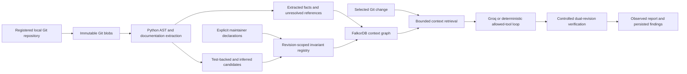

# Project Context Architecture

FAULTLINE now has an additive, source-backed project context layer. The existing regression graph, APIs, Groq tool loop, allowed scenario interpreter and execution policy remain in place. Context is stored in a separate FalkorDB graph named `<FZ_GRAPH_NAME>_context`; it cannot collide with the earlier synthetic graph.

Origins are explicit: Git structure/commits, AST definitions/imports/statically resolved calls, test assertions, documentation snippets, operator declarations, and executed observations. These sources never share a single undifferentiated "truth" category. Repository prose is untrusted data and cannot override tool restrictions.

The HTTP surface is limited to the bundled `trusted-commerce` repository and six known revision references. Operator-only source indexing also works on other local Python Git repositories through `context_graph_builder` CLI; that path executes no source or tests and imports no demo declarations. It is not arbitrary repository investigation or GitHub onboarding.

Before a production Git investigation, `ProjectContextService.prepare_change` indexes/reuses original and candidate snapshots and retrieves a bounded package for the changed symbols. The package includes approved scoped invariants, connected services, tests, source references, separately labeled hypotheses, historical findings, coverage gaps and measured timing. It is recorded as `retrieve_project_context`, persisted on the report and supplied to the model as untrusted context data. Existing graph plans and uncovered rules are intersected with the approved context invariant IDs. Missing context cannot be replaced by an invented rule.

Project Understanding exposes counts, real indexed sources, provenance, missing documentation/tests, candidate categories and a context explorer. The review UI is explicitly read-only. A separate disabled-by-default maintainer endpoint supports persisted review when a dedicated credential is configured.

Production GitHub installation authorization, webhook signatures, multi-user repository permissions, asynchronous workers and hardened execution isolation remain planned. This prototype is not asserted production-ready.
